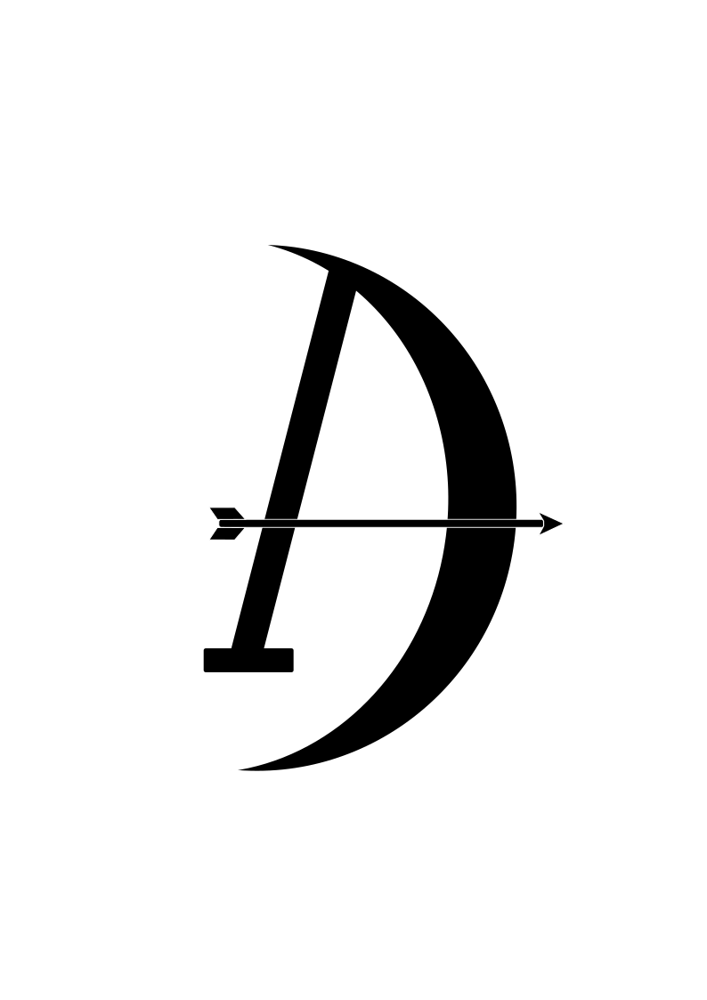
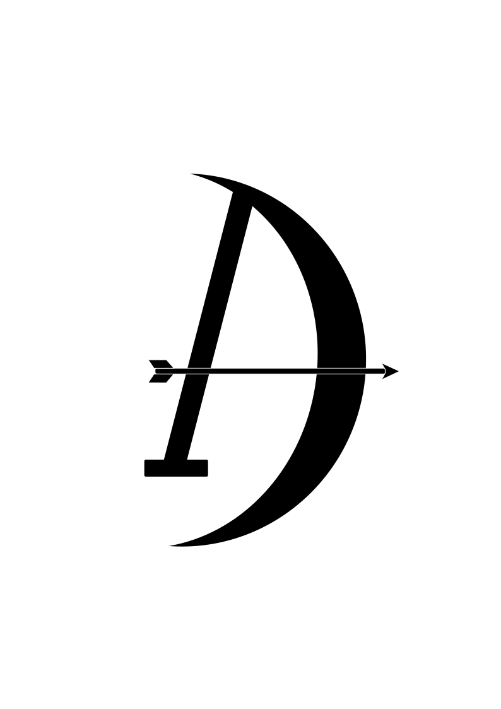

This is my attempt at making a logo. Its okay to use as is, as base for some modified derivative or inspiration for something similar.

Current svg file has the icon background, it should be trivial to remove or replace if needed. Logo is made using Incscape (probably not according to any form of best practice, this is my first time using the software).

Its leaning into the mythology around Artemis, attempting to depict the crescent moon as part of a bow and arrow, formed into an "A". 

I made an image search for "artemis logo" just to see what came up and found some designs that where similar to what I had made.
Not that I have copied them, but they are similar and I don't know enough about how licensing and copyright work in this area so for transparrency and "better safe than sorry" I'm linking the images here:

https://mir-s3-cdn-cf.behance.net/projects/404/46492b220843495.Y3JvcCwxOTY5LDE1NDAsNDk3LDE5NA.jpg
https://www.pngitem.com/pimgs/m/593-5932795_artemis-logo-hd-png-download.png
https://artemissupports.com/wp-content/uploads/2020/01/ArtemisLogo_final_rgb.png

#### No Background Version

  

[Download No Background version](anton-roskvist_artemis.png)

#### Background Version

  

[Download Background version](anton-roskvist_artemis_icon.png)

[Download svg version](anton-roskvist_artemis.svg)

