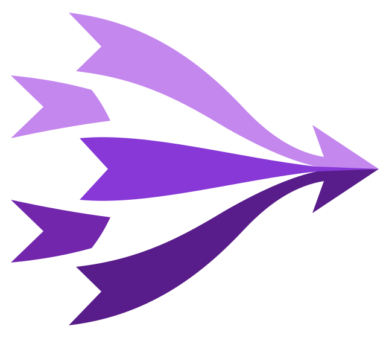
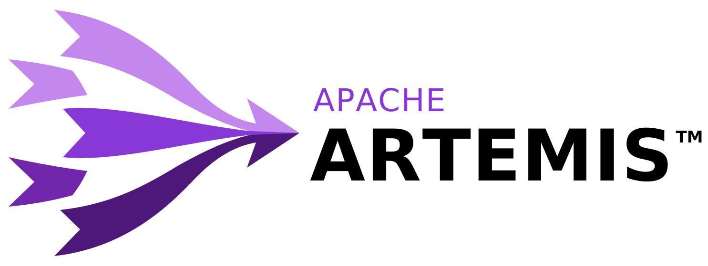
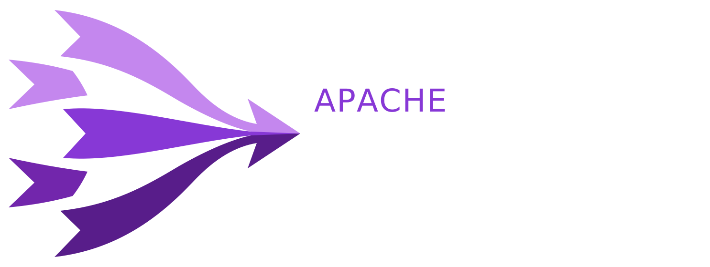

# Apache Artemis Logo Submission

## Concept 2: Fan-in / Fan-out Stream Bundle

This submission presents a standalone, scalable vector logo concept for **Apache Artemis**, visualizing multiple independent message streams converging into a single high-throughput forward vector. The fletched, arrow-inspired tails can be related to the Greek godess as well.

  

[Download icon version](marcel-bil-artemis-logo-2a.svg)

#### Dark Background Version

  

[Download dark version](marcel-bil-artemis-logo-2c-dark.svg)

#### Light Background Version

  

[Download light version](marcel-bil-artemis-logo-2c-light.svg)

