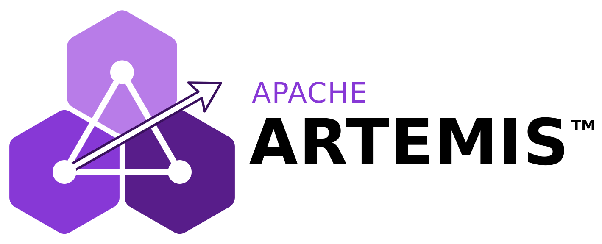
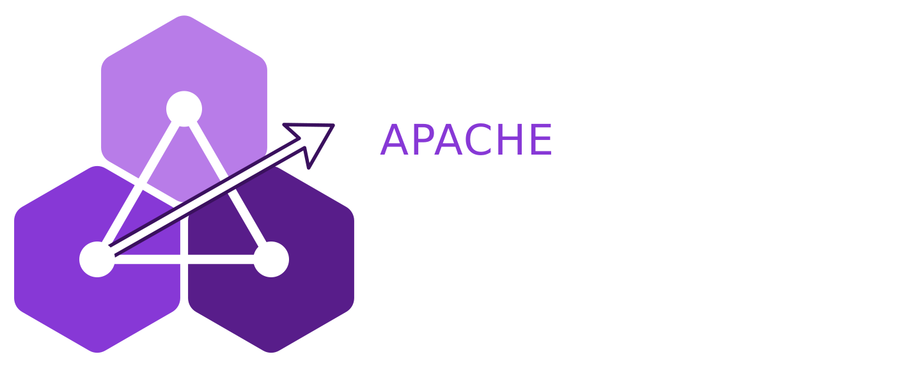

Apache Artemis - Logo suggestion 1: 3 hexagons combined (activemq heritage but haxagons are also used in the current web console) + connection triangle which may also act as a bow and arrow (related to the goddess Artemis).

#### Icon

  

#### Dark Background Version

  

[Download light version](marcel-bil-artemis-logo-1c-light.svg)

#### Light Background Version

  

[Download dark version](marcel-bil-artemis-logo-1b-dark.svg)
